# ☀️ Agentic AI News Impact System

**A team of AI agents that reads the news for a solar module maker, and says what it means for the business.**

Ask a question in English or Hinglish, like *"Coal ka rate badha hai kya, mere module cost pe kya asar padega?"*. In about a minute, nine agents search the last 30 days of news, merge duplicate reports, work out each story's impact (positive or negative, how big, short or long term), and write a short summary. Every point links to its source, and anything an article does not back up is dropped.

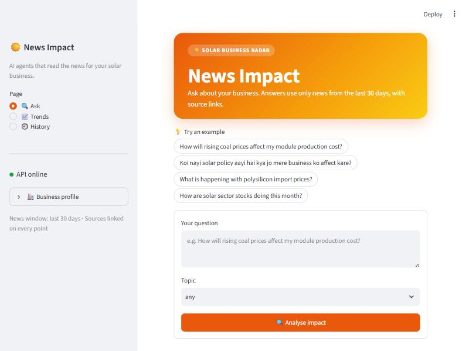

> Screenshots in this README use demo data.

---

## ✨ What it does

| | Feature | What you get |
|---|---|---|
| 🤖 | **Live agent board** | Watch every agent work in real time: three search agents in parallel, then per-article progress |
| 🗞️ | **Impact cards** | Sentiment, level, horizon, a word-for-word quote from the article, and why it matters |
| 🔗 | **Duplicate merge** | The same story from several sites becomes one card ("Also reported by …") |
| 💬 | **Follow-up chat** | Ask *"Ispe mujhe kya karna chahiye?"* and get ideas that cite the news above |
| 📈 | **Trends** | News mood from −100 to +100 over a week, month or quarter, and which themes are getting better or worse |
| 📧 | **Daily email brief** | A styled morning report in your inbox, scheduled with Windows Task Scheduler |
| 🧪 | **Real-data eval** | 13 questions run on live data and checked automatically, so prompt changes cannot quietly break quality |

---

## 📸 A quick tour

**1. The agents at work.** Each card lights up as its agent runs. The three search agents run at the same time.

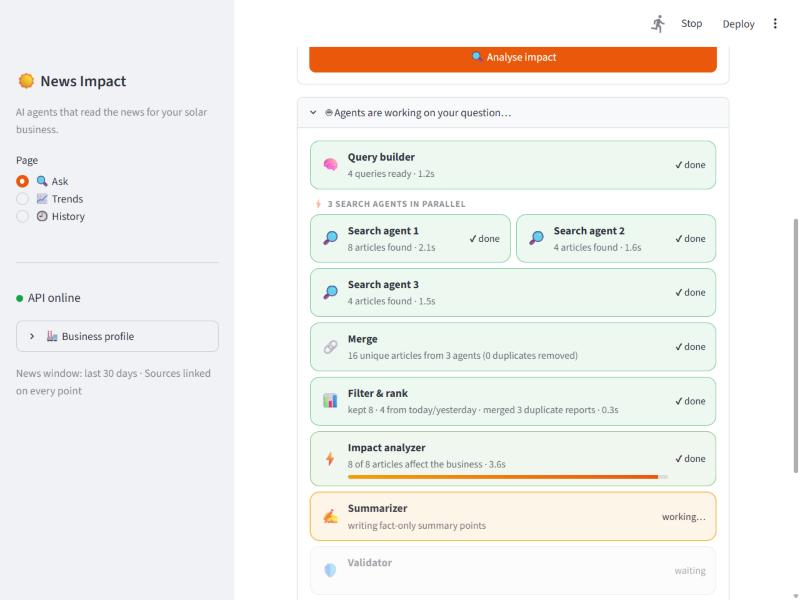

**2. The answer.** Counts, a sourced summary, and an impact breakdown.

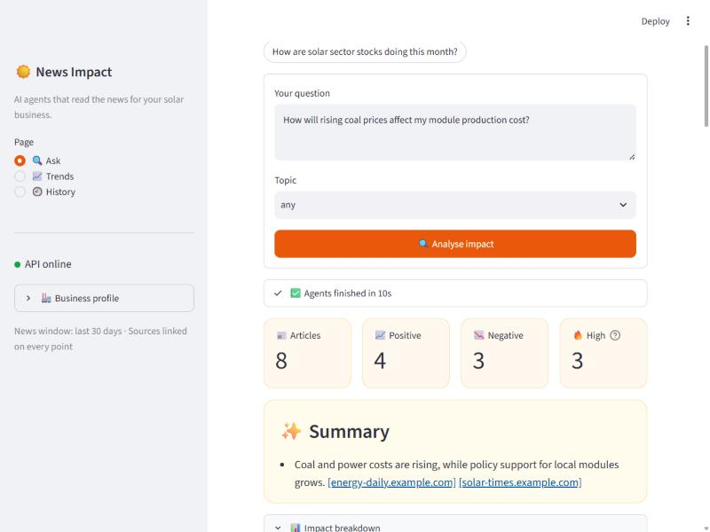

**3. Impact cards.** Each card has a quote taken word for word from the article and the analysis of what it means. Duplicate reports from other sites are folded into one card.

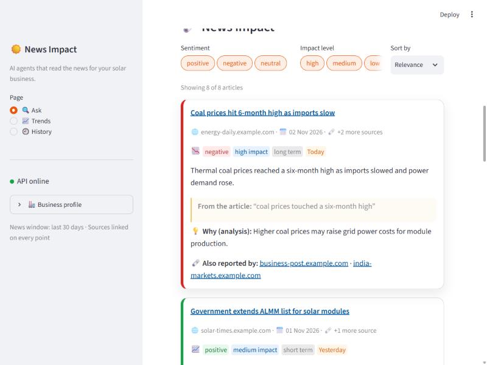

**4. Follow-up questions.** The answers use only the news above and cite it.

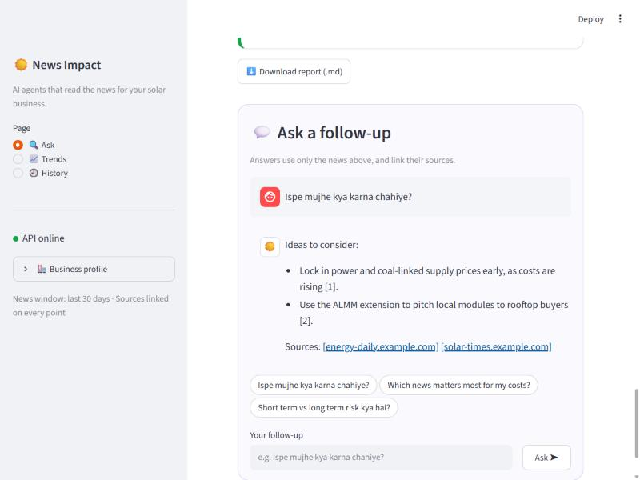

**5. Trends.** Is coal news getting more negative? Is policy news turning positive?

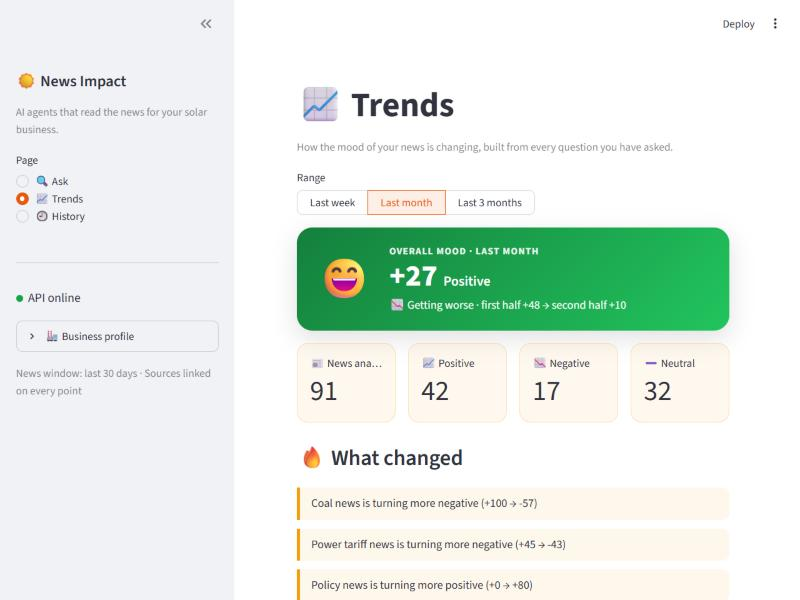
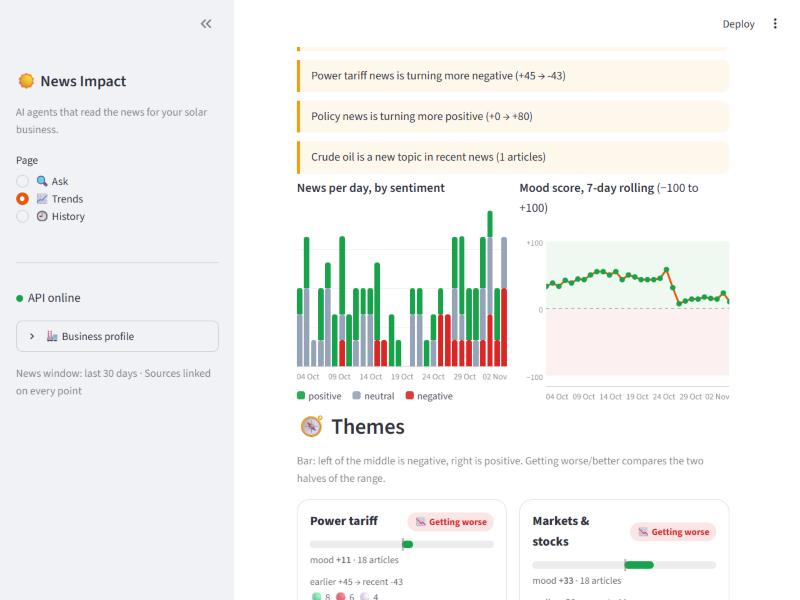
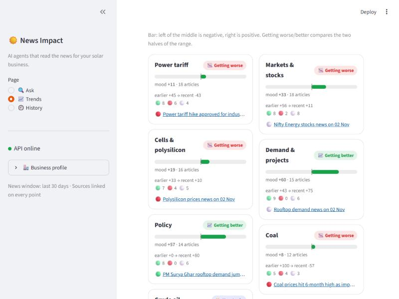

**6. The morning email.**

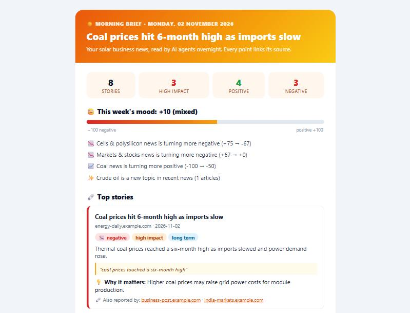

---

## 🏗️ Architecture

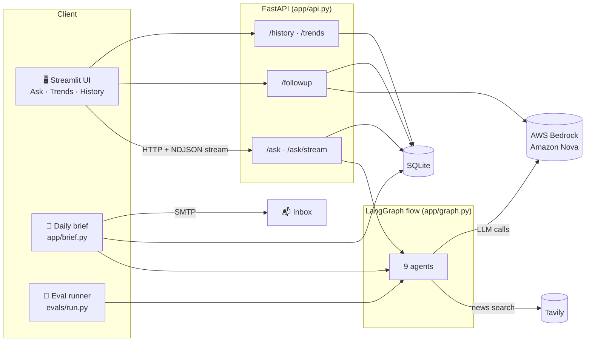

- The **UI only talks to the API**. It never touches the graph or the database.
- The **graph never touches the database**. The API saves each run, and the daily brief saves its own runs so they show up in History and Trends.
- **Every agent reports what it is doing** through `app/trace.py`. The API prints those events as colored log lines and streams them to the UI.

---

## 🔄 How a question flows

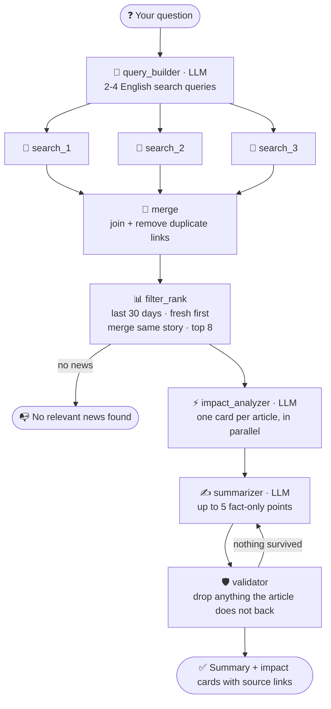

| # | Agent | Uses LLM | Job |
|---|---|:---:|---|
| 1 | **query_builder** | ✅ | Turns the question (English or Hinglish) into 2-4 English search queries |
| 2-4 | **search_1/2/3** | | The queries are split across three agents that search Tavily **at the same time**. If one fails, the others carry on |
| 5 | **merge** | | Joins the three result lists and removes duplicate links |
| 6 | **filter_rank** | | Drops undated or old news, puts today's and yesterday's first, **folds the same story from different sites into one**, keeps the top 8 |
| 7 | **impact_analyzer** | ✅ | One card per article (sentiment, level, horizon, reason, quote), several at once (`IMPACT_CONCURRENCY`) |
| 8 | **summarizer** | ✅ | Up to 5 fact-only points, each citing its articles |
| 9 | **validator** | | Drops cards whose quote is not in the article, points with unknown sources or invented numbers, and summaries not grounded in the text. Code adds the links |

### Live streaming, step by step

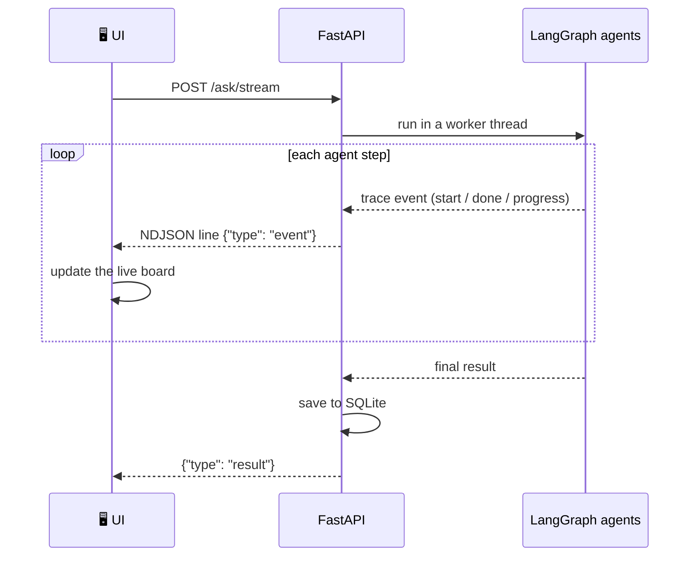

The same events show up in the API terminal:

```
╭─ 🚀 New run · "How will rising coal prices affect my module production cost?"
│   1.25s  🔎 search_1        ▶ "coal price India" | "Nifty energy"
│   1.25s  🔎 search_2        ▶ "ALMM solar policy"
│   1.25s  🔎 search_3        ▶ "polysilicon price"
│   2.44s  🔎 search_3        ✔ 4 articles found (1.19s)
│   3.00s  📊 filter_rank     ✔ kept 8 · 4 from today/yesterday · merged 3 duplicate reports (0.30s)
│   3.44s  ⚡ impact_analyzer • [1/8] negative · high · "Coal prices hit 6-month high as imports slow"
│   8.70s  🛡️  validator       ✔ 8 cards · 4 points backed by sources (0.59s)
╰─ ✅ ok in 8.70s
```

---

## 🛡️ Rules the system never breaks

1. Every claim links to a source, and a claim without one is dropped.
2. Only news from the last 30 days that has a date is used.
3. Today's and yesterday's news comes first.
4. No invented facts, numbers, names or dates. If nothing is found, it says *"No relevant news found"*.
5. Every impact card has a sentiment, a level, a one-line reason and a horizon.
6. The LLM only sees article text and returns article IDs. **Code adds every URL.**
7. API keys live only in `.env`.

---

## 🚀 Setup (Windows)

```bash
python -m venv .venv
.venv\Scripts\activate
pip install -r requirements.txt
copy .env.example .env
```

Fill in `.env`:

| Setting | What it is |
|---|---|
| `AWS_ACCESS_KEY_ID`, `AWS_SECRET_ACCESS_KEY`, `AWS_REGION` | Bedrock access |
| `MODEL_QUERY`, `MODEL_IMPACT`, `MODEL_SUMMARY` | Bedrock model IDs (Amazon Nova) |
| `TAVILY_API_KEY` | News search |
| `MAX_ARTICLES` (8), `DAYS` (30) | How many stories, and how far back |
| `IMPACT_CONCURRENCY` (3) | Articles analysed at once. Raise it only if Bedrock does not throttle |
| `TRACE_LOGS` (1) | Colored agent lines in the API terminal (`0` turns them off) |
| `SMTP_*`, `BRIEF_TO`, `APP_URL` | Daily email brief (see below) |

## ▶️ Run

Start the API, then the UI in a second terminal:

```bash
uvicorn app.api:app --host 127.0.0.1 --port 8000
```
```bash
streamlit run ui/streamlit_app.py
```

Open http://localhost:8501.

### API

| Endpoint | What it does |
|---|---|
| `POST /ask` | Runs the agents and returns the answer |
| `POST /ask/stream` | Same, but streams every agent event as NDJSON and ends with the result |
| `POST /followup` | Answers a follow-up using only that answer's news cards |
| `GET /history`, `GET /history/{id}` | Past questions, with their follow-ups |
| `GET /trends?days=7\|30\|90` | Mood, news per day by sentiment, and themes |
| `GET /health` | Health check |

---

## 📧 Daily email brief

Every morning the brief asks three standing questions (energy prices, policy, market) and emails one styled report. It has the top headline, stats, this week's mood meter with the themes that moved, the top stories with quotes, and a short summary per topic.

1. Fill in `SMTP_USER`, `SMTP_PASSWORD` (a Gmail **App Password**) and `BRIEF_TO` in `.env`.
2. Preview it without sending. This writes `briefs/brief-<date>.html`:
   ```bash
   python -m app.brief --dry-run
   ```
3. Send it once:
   ```bash
   python -m app.brief
   ```
4. Schedule it every day at 8 AM. If the PC is off at that time, it runs when the PC is next on:
   ```bash
   powershell -ExecutionPolicy Bypass -File scripts\schedule_brief.ps1 -Time 08:00
   ```
   Remove it with `-Remove`. The log goes to `briefs\brief.log`.

---

## 🧪 Quality eval on real data

`evals/cases.json` holds 13 questions: English, Hinglish, and two off-topic ones (IPL, biryani) that must return no news.

```bash
python -m evals.run
```

Every answer is checked automatically:

- ✅ the status is allowed (`ok` or `no_news`)
- ✅ every summary point has a valid source
- ✅ every card is from the last 30 days, with fresh news first
- ✅ every quote appears word for word in its article
- ✅ there are no URLs in LLM-written text
- ✅ the cards are on topic
- ✅ off-topic questions produce no cards

Each run is saved in `evals/results/` and compared with the previous one. A case that passed before and fails now is flagged as a **REGRESSION** (exit code 1). Run it before and after you change a prompt. Use `--only coal-cost,almm` to run a few cases, and `--min-score 0.9` to set a pass bar.

This makes real Tavily and Bedrock calls, about 13 runs.

---

## 🗂️ Project layout

```
app/
  api.py             FastAPI: /ask, /ask/stream, /followup, /history, /trends
  graph.py           LangGraph flow (9 agents, parallel search)
  nodes/             query_builder · news_search · filter_rank · story_merge
                     impact_analyzer · summarizer · validator · followup
  trace.py           agent events: colored terminal lines + live UI stream
  trends.py          mood scores by day and by theme
  brief.py           daily email brief
  prompts.py         every LLM prompt
  schemas.py         data models
  db.py              SQLite: queries, articles, impacts, follow-ups
  config.py          settings from .env
  profile.py         business profile and topics
  llm.py             Bedrock model setup
ui/
  streamlit_app.py   Ask, Trends and History pages
  board.py           live agent board
  trends_view.py     Trends page and charts
scripts/
  schedule_brief.ps1 Windows Task Scheduler setup
evals/               real-data eval: cases, checks, runner
docs/images/         screenshots
tests/               pytest (Tavily, Bedrock and SMTP are mocked)
```

## ✅ Tests

```bash
pytest
```

All external services are mocked, so the tests run offline in about 20 seconds.

## 📚 Docs
- [REQUIREMENTS.md](REQUIREMENTS.md): goals and rules
