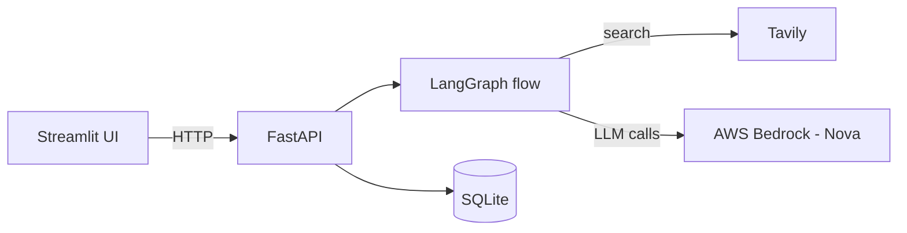

# Agentic AI News Impact System

Ask a question about a solar module business. Agents fetch the last 30 days of news, explain each story's business impact, and show a short summary with source links.

## Stack
- Python, FastAPI, Streamlit
- LangGraph + LangChain
- AWS Bedrock (Amazon Nova), Tavily search
- SQLite

## Architecture

The UI only talks to the API. The API runs the graph and is the only part that writes to the database.

## Flow
1. **query_builder** (LLM): turns the question (English or Hinglish) into 2-4 English search queries.
2. **news_search**: runs the queries on Tavily for the last 30 days and removes duplicates.
3. **filter_rank**: drops undated or older news, puts today's and yesterday's first, keeps the top 8.
4. **impact_analyzer** (LLM): one card per article with sentiment, level, horizon, reason and a quote from the article.
5. **summarizer** (LLM): up to 5 fact-only points with source IDs.
6. **validator**: drops cards and points not backed by the article text; code adds the source links.

If no news is found, the flow stops with "No relevant news found".

## Folder structure
```
app/
  config.py        settings from .env
  .env.example     add your api keys and config in this 
  profile.py       business profile and competitors
  schemas.py       data models
  llm.py           Bedrock model setup
  prompts.py       all prompts
  nodes/           query_builder, news_search, filter_rank, impact_analyzer, summarizer, validator
  graph.py         LangGraph flow
  db.py            SQLite storage
  api.py           FastAPI endpoints
ui/
  streamlit_app.py Ask and History pages
tests/             pytest tests (Tavily and Bedrock are mocked)
```

## Setup (Windows)
```bash
python -m venv .venv
.venv\Scripts\activate
pip install -r requirements.txt
copy .env.example .env
```
Fill in `.env`: AWS keys and region, `TAVILY_API_KEY`, and the Bedrock model IDs (`MODEL_QUERY`, `MODEL_IMPACT`, `MODEL_SUMMARY`).

## Run
Start the API, then the UI in a second terminal:
```bash
uvicorn app.api:app --host 127.0.0.1 --port 8000
streamlit run ui/streamlit_app.py
```
Open http://localhost:8501.

## Test
```bash
pytest
```

## Docs
- [REQUIREMENTS.md](REQUIREMENTS.md): goals and rules
- [PLAN.md](PLAN.md): design and build steps
